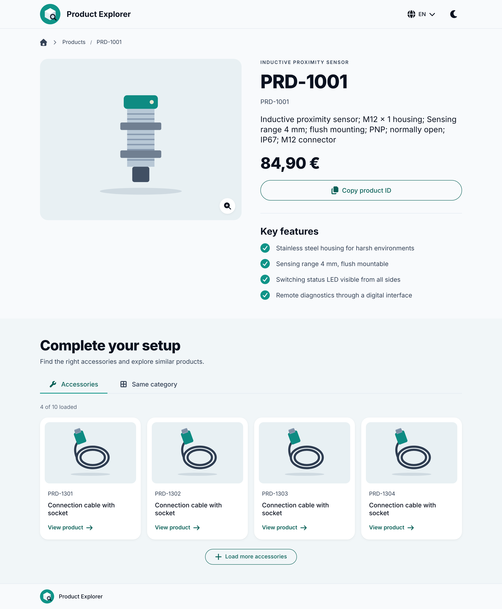

# Product Explorer

**[Live demo](https://product-explorer-dusky.vercel.app)** · Vue 3 · TypeScript · Pinia · Vite ·
Vitest · hexagonal architecture

[](https://product-explorer-dusky.vercel.app)

A product detail page for an industrial sensor catalog, built with **Vue 3 + TypeScript** in a
hexagonal (ports and adapters) architecture. It shows one main product (photo, information,
variants, key features) and below it, in two tabs, its **accessories** and the **other products of
its category**.

The focus is on staying smooth when the API is slow: every card loads on its own, only a few
requests run at the same time, outdated requests are cancelled, and every section and every card
has its own loading and error state.

It runs out of the box on a **fictional mock catalog** (30 products, 5 categories, accessories and
variants) stored as local JSON files. A real catalog API can be plugged in through one environment
variable, without changing core or UI.

## Highlights

- **Stays smooth on a slow API:** accessory lists load in pages of 4 cards, at most 4 requests run
  at the same time, and outdated requests are cancelled with `AbortController`.
- **Failures stay local:** every section and every card has its own loading and error state with
  "Try again", so one broken request never breaks the page.
- **External data is validated:** every response is checked (`readX`) before it is mapped to
  domain types (`convertX`), so a format change fails loudly instead of showing broken data.
- **Hexagonal monorepo:** framework-free `core`, swappable adapters in `infrastructure`, Vue in
  `app`. The mock catalog and a real REST API plug into the same port.
- **German and English** UI with the language in the URL, light and dark theme, WCAG AA contrast
  checked by tests.
- **641 Vitest tests** across all three packages.

## Tech stack

| Area       | Tools                                                            |
| ---------- | ---------------------------------------------------------------- |
| Frontend   | Vue 3 (Composition API), TypeScript, Vue Router, Pinia, vue-i18n |
| Styling    | SCSS with design tokens, light and dark mode                     |
| Build      | Vite, npm workspaces                                             |
| Quality    | Vitest, Vue Test Utils, ESLint, Prettier, `vue-tsc`              |
| Deployment | Vercel                                                           |

## Getting started

Requires Node.js `^20.19.0 || >=22.12.0` (see `.nvmrc`).

```bash
npm install
npm run dev        # http://localhost:5173 → opens PRD-1001
npm run test       # all tests (Vitest)
```

| Script                              | What it does                               |
| ----------------------------------- | ------------------------------------------ |
| `npm run dev`                       | dev server, on the mock catalog by default |
| `npm run test` / `test:watch`       | Vitest for all three packages              |
| `npm run typecheck`                 | `tsc` / `vue-tsc` for all packages         |
| `npm run lint` / `npm run format`   | ESLint / Prettier                          |
| `npm run build` + `npm run preview` | production build, served locally           |

URLs have the form `/{country}/{language}/product/{productId}`, e.g. `/de/en/product/PRD-1001`
(sensor with accessories) or `/de/de/product/PRD-1301` (a cable in four lengths).

### Configuration

Copy `.env.example` to `.env` to change the defaults:

| Variable                | Default | Effect                                                                     |
| ----------------------- | ------- | -------------------------------------------------------------------------- |
| `VITE_CATALOG_ADAPTER`  | `mock`  | `mock`: local JSON catalog · `http`: a catalog REST API                    |
| `VITE_CATALOG_API_URL`  | –       | API base URL for `http`; the dev server proxies `/api/*` to it             |
| `VITE_CATALOG_SITE_URL` | –       | Website with a page per product; shows a "View on website" button when set |
| `VITE_MOCK_DELAY_MS`    | `250`   | Simulated latency of the mock catalog                                      |

The HTTP adapter expects the format documented in
[`docs/TECHNICAL_CONCEPT.md`](docs/TECHNICAL_CONCEPT.md#catalog-api-format)
(`GET products/{id}`, `products/{id}/accessories`, `products/{id}/variants`,
`categories/{id}/products`).

### Demo mode: slow and failing requests on demand

In `npm run dev`, adding `?demo` to the URL lets you trigger every state on purpose:

| URL                                                                | Shows                                    |
| ------------------------------------------------------------------ | ---------------------------------------- |
| `/de/en/product/PRD-1001?demo&delay=2000`                          | every request takes 2 s: loading states  |
| `/de/en/product/PRD-1001?demo&delay=forever`                       | requests never answer                    |
| `/de/en/product/PRD-1001?demo&fail=PRD-1302=timeout`               | one card fails, with "Try again"         |
| `/de/en/product/PRD-1001?demo&fail=accessories:PRD-1001=server`    | the accessory list fails, the rest works |
| `/de/en/product/PRD-1001?demo&fail=PRD-1001=network`               | the main product fails                   |
| `/de/en/product/PRD-1001?demo&image=PRD-1001=broken,PRD-1301=none` | broken / missing photos                  |

Failure kinds: `timeout`, `server`, `network`, `invalid`. Several entries are separated by commas.

The mock catalog also contains these cases permanently: `PRD-1007` has no accessories, `PRD-1105`
has no photo, `PRD-1402` has no public price, and `PRD-1001` lists a discontinued accessory
(`PRD-1999`) that shows as "No longer available".

## Architecture

Hexagonal (ports and adapters) as an npm-workspaces monorepo:

```
packages/
  core/            # entities, errors, ports, services: plain TypeScript, no Vue, no fetch
  infrastructure/  # MockCatalogAdapter (JSON files) and HttpCatalogAdapter + RestClient
  app/             # Vue 3: router, pages, sections, components, Pinia stores, i18n, styles
```

- **Dependency rule:** `app → core`, `infrastructure → core`, and `app → infrastructure` only in
  `app/src/api`. Core depends on nothing, so it is tested without a browser or network.
- **One port, `ProductPort`:** product, accessory groups, category products, variants. The core
  services validate ids and turn every failure into a typed `DomainError` with a `retryable` flag,
  which the UI uses to decide whether to offer "Try again".
- **Two adapters, one format:** `MockCatalogAdapter` and `HttpCatalogAdapter` share the same
  two-step converters: `readX` checks a response body at runtime, `convertX` maps it to core
  types. The mock data goes through the same validation as a real response.
- **Composition root:** `createCatalogServices(locale)` in `app/src/api` picks the adapter from
  `VITE_CATALOG_ADAPTER` and wraps it with core's `createServices`. Stores call it with the country
  and language from the URL. Tests replace this module with core's `MockProductAdapter`.
- **Stores:** one per data source (`product`, `variants`, `accessories`, `category-products`),
  each started by exactly one section. A section that fails never affects the others.
- **One place for the id rule:** `PRODUCT_ID_PATTERN` in `core/src/fields/product-id`. Changing the
  id format is one regex and its tests.

The full design, with tables of all states and decisions, is in
[`docs/TECHNICAL_CONCEPT.md`](docs/TECHNICAL_CONCEPT.md).

## Handling a slow API

| Problem                        | Solution                                                                                  |
| ------------------------------ | ----------------------------------------------------------------------------------------- |
| Many accessories               | Pages of 4 cards ("Load more"); ids deduplicated across groups                            |
| One request per card           | At most 4 requests at a time (worker pool in `stores/product-cards`)                      |
| One slow or failing card       | Every card has its own state: loading, ready, error ("Try again"), or no longer available |
| Slow answer for an old product | Each load cancels the previous one (`AbortController`); stale answers are ignored         |
| A request that never answers   | 8 s timeout in the `RestClient`, then a timeout message with "Try again"                  |
| Work nobody looks at           | The "Same category" tab loads only when it is first opened                                |
| Repeated requests              | The browser's HTTP cache (as far as the API's `Cache-Control` allows), no own cache       |

The first view of a product makes 7 requests: product, variants, accessory list, 4 accessory
cards. Tests in `pages/MainPage.test.ts` make sure nothing is requested twice, also after a
language switch.

## Decisions and trade-offs

- **Mock catalog by default.** The app is fully usable without a backend; the mock adapter is a
  real port implementation, not a test double, and reuses the HTTP adapter's validation.
- **CORS via the Vite proxy** (HTTP adapter only). The browser calls `/api/…` and Vite forwards it
  to `VITE_CATALOG_API_URL`. A real deployment would need the same rule in its web server or a
  small backend.
- **No own cache, no TanStack Query.** The HTTP cache covers repeated requests. A query library
  would replace a large part of the architecture for little gain at this size.
- **No automatic retries.** The user decides with "Try again", per section and per card. Automatic
  retries with backoff would be the next step for flaky networks.
- **Card loading lives in the app, not in core.** `loadProductCards()` (worker pool) sits in
  `app/src/stores/product-cards`. A `ProductBatchService` in core would make it reusable outside
  Vue; for one app that was not worth the extra layer yet.
- **Language in the URL.** `/de/en/…` decides the UI texts and the API language, so links are
  shareable. The language switcher replaces the URL; `/` uses the saved or browser language.
  The country is never guessed, because it decides price and currency.
- **Validated responses.** Every response is checked (`readX`) before it is mapped (`convertX`),
  so a format change fails loudly instead of showing broken data.
- **Design tokens in one place.** All colours live in `styles/tokens/_palette.scss`; semantic
  tokens map them for light and dark mode. The UI uses the system font stack.
- **Accessibility:** native elements (`<dialog>`, buttons, links), `aria-live` progress, one
  announcement per failure instead of one per card, WCAG AA contrast checked by a test for both
  themes, `prefers-reduced-motion`.

### Not in scope

Header search, account and favourites, an image gallery (one photo per product), and category
names in the breadcrumbs (the port only returns category ids).

### Known issues

- `npm audit` reports advisories in Vitest (test tooling only, nothing shipped to the browser). The
  fix needs the next major Vitest version.
- The repo has both `package-lock.json` (for `npm install`) and `yarn.lock`. Both pin the same
  versions.

## Tests

Over 640 Vitest tests, next to the code (`*.test.ts`):

- **core:** id validation, error conversion, every service against the mock adapter
- **infrastructure:** `RestClient` status → error mapping, response validation and mapping per
  endpoint, the mock catalog adapter and the consistency of the mock data
- **app:** components in all states, stores (cancelling, stale answers, paging, parallel limit),
  sections, router, i18n, configuration, demo mode, colour contrast of both themes, and
  request-count guards for the page

## Roadmap

- **Backend (in progress):** a NestJS API with PostgreSQL and Prisma that serves the catalog in the
  format the `HttpCatalogAdapter` already expects, so the frontend switches over with
  `VITE_CATALOG_ADAPTER=http` and no code changes.
- Automatic retries with backoff for flaky networks.
- Category names in the breadcrumbs once the API provides them.
